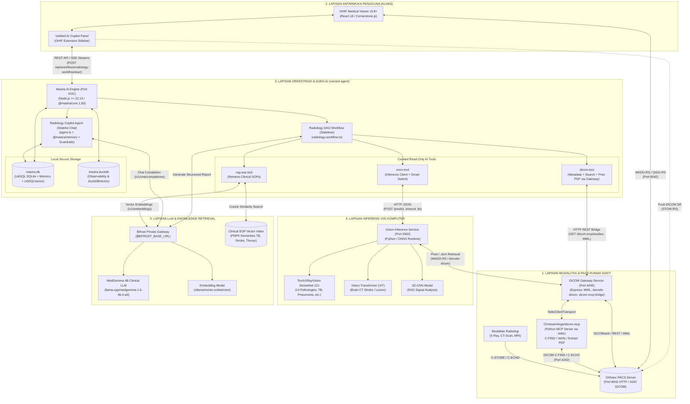
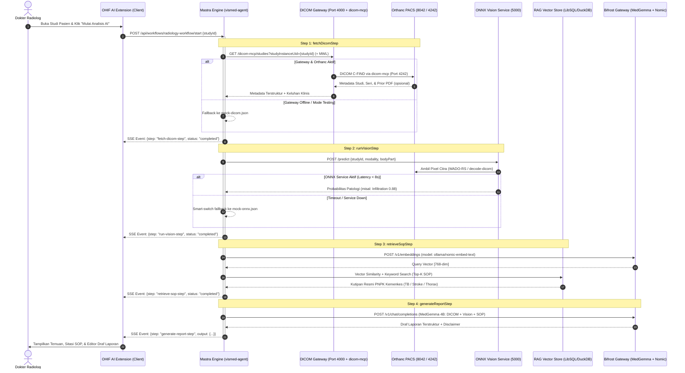
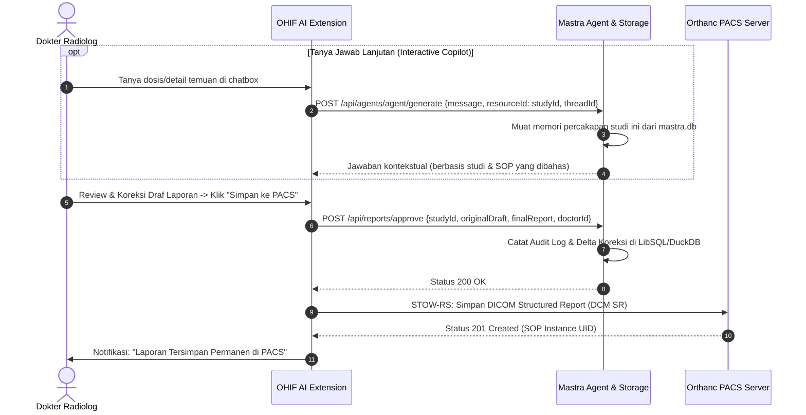

# ARSITEKTUR SISTEM DARSI (Digital Assistant Rumah Sakit Islam)
## VisMed Radiology AI Copilot: Multimodal GenAI Microservice & PACS Integration

**Penulis:** Rahadyan Danang Susetyo Pranawa (NRP: 3123522018 / 3126640054)  
**Program Studi:** D4 Terapan Teknik Informatika, Politeknik Elektronika Negeri Surabaya (PENS)  
**Proyek:** Proyek Akhir (PA) - Integrasi Visual Medis PACS dengan Generative AI Klinis  
**Versi Dokumen:** 2.1 (Revisi Arsitektur + Bridge `dicom-mcp` & Agent Memory)  
**Tanggal Rilis:** November 2026  

---

## 1. Ringkasan Eksekutif & Filosofi Sistem

Sistem **DARSI (Digital Assistant Rumah Sakit Islam)** adalah arsitektur *Clinical Decision Support System (CDSS)* berbasis kecerdasan buatan multimodal yang dirancang untuk mengintegrasikan sistem pengarsipan citra medis (*Picture Archiving and Communication System* / PACS) dengan model visi komputer (*Computer Vision*) dan *Large Language Model* (LLM) klinis secara *on-premise*.

### Prinsip Utama Desain (Core Principles):
1. **Zero Cloud Data Leakage (Kepatuhan UU PDP No. 27/2022 & HIPAA):** Citra medis DICOM dan data identitas pasien (*Protected Health Information* / PHI) tidak boleh meninggalkan infrastruktur lokal rumah sakit. Seluruh pemrosesan inferensi visi, penyimpanan vektor RAG, dan basis data audit berjalan lokal (*air-gapped / on-premise*).
2. **Deterministic-First Workflow Architecture:** Alur kerja kritis (akuisisi DICOM $\rightarrow$ inferensi visi komputer $\rightarrow$ RAG SOP retrieval $\rightarrow$ sintesis laporan) diorkestrasi menggunakan *Directed Acyclic Graph* (DAG) yang deterministik berbasis Mastra Workflows. Agen otonom hanya digunakan untuk asisten dialog interaktif, bukan pada *core diagnostic pipeline*.
3. **Evidence-Grounded RAG (Pencegahan Halusinasi Klinis):** Laporan radiologi tidak dihasilkan secara bebas oleh LLM, melainkan diverifikasi (*grounded*) terhadap Panduan Nasional Pelayanan Kedokteran (PNPK Kemenkes RI) dan *Hospital Clinical Pathways* lokal melalui subsistem RAG.
4. **Decoupled Multi-Service Architecture:** Frontend penampil medis (OHIF Viewer), jembatan DICOM (`dicom-gateway` + `dicom-mcp`), orkestrator AI (Mastra Agent), dan mesin inferensi visi (ONNX Runtime) dipisahkan secara modular melalui protokol standar industri (DICOM C-FIND/C-STORE, DICOMweb, RESTful JSON, MCP, dan Server-Sent Events).
5. **Curated Read-Only Tooling untuk LLM Kecil (4B):** Untuk model *edge* seperti MedGemma 4B, akses ke protokol PACS dibatasi melalui *gateway* dan *tool* yang terkurasi (*read-only* metadata/pencarian studi), sehingga mencegah kesalahan pemanggilan fungsi atau tindakan mutasi node PACS yang berbahaya.

---

## 2. Diagram Arsitektur Tingkat Tinggi (High-Level Architecture)

Berikut adalah diagram arsitektur sistem DARSI secara menyeluruh, termasuk integrasi **`dicom-gateway` (Port 4000)** yang menjembatani **`ChristianHinge/dicom-mcp`** dengan Orthanc PACS:



---

## 3. Rincian 6 Komponen Inti Sistem

Sistem DARSI terdiri dari 6 komponen inti yang saling terisolasi dengan kontrak data (*data contract*) yang jelas:

### Komponen 1: Lapisan Data Medis, PACS, & DICOM Gateway (`dicom-mcp` Bridge)
- **Komponen Utama:** Orthanc PACS Server (`8042`/`4242`) dan **`vismed-PACS/apps/dicom-gateway`** (`4000`).
- **Arsitektur Bridge `dicom-mcp`:**
  - `dicom-gateway` menjalankan `ChristianHinge/dicom-mcp` (`uv run dicom-mcp configuration.yaml --transport stdio`) sebagai proses tunggal melalui `@modelcontextprotocol/sdk` (`StdioClientTransport` di `services/dicomMcpClient.js`) dan mengeksposnya via HTTP Express router (`/dicom-mcp/*`).
  - Mastra (`vismed-agent`) memanggil HTTP endpoint `dicom-gateway` ini—bukan menjalankan proses `dicom-mcp` kedua—sehingga koneksi AE Title ke Orthanc terpusat dan bebas konflik sesi.
- **Pemisahan Jalur Metadata vs Pixel (Krusial):**
  - **Jalur Metadata & Prior Report (`dicom-mcp`):** Mengambil metadata studi/pasien/seri via `C-FIND` (`query_patients`, `query_studies`, `query_series`), verifikasi koneksi (`verify_connection`), serta membaca teks laporan PDF terdahulu yang terenkapsulasi di DICOM (`extract_pdf_text_from_dicom`), diperkaya keluhan klinis dari Modality Worklist (`routes/mwl-server/mwl-read`).
  - **Jalur Pixel Citra (`decode-dicom` / WADO-RS):** `dicom-mcp` **tidak mengirimkan piksel gambar** untuk inferensi visi komputer. Oleh karena itu, layanan visi ONNX tetap mengambil data citra dari Orthanc REST/WADO-RS atau modul `decode-dicom` di `dicom-gateway`.
- **Keamanan Bridge & Input:**
  - Endpoint generik `POST /dicom-mcp/tool` pada `dicom-gateway` wajib dilindungi *allowlist* tool *read-only* agar AI tidak dapat memanggil mutasi node seperti `switch_dicom_node`, `switch_calling_aet`, atau `move_series` tanpa otorisasi eksplisit.
  - Format `studyId` pada validasi Zod Mastra harus mendukung `StudyInstanceUID` standar DICOM yang mengandung tanda titik (`.`), misalnya `1.2.840.113619.2.55.3.4270889` (regex `/^[A-Za-z0-9._-]{1,128}$/`).

### Komponen 2: Mesin Inferensi Visi Komputer (ONNX Computer Vision Engine)
- **Komponen Utama:** FastAPI / Flask Microservice (Port `5000`), ONNX Runtime (CPU OpenVINO / GPU CUDA).
- **Model yang Dikelola:**
  1. **TorchXRayVision DenseNet-121:** Deteksi 14 patologi toraks (Atelectasis, Consolidation, Infiltration, Pneumothorax, Edema, Emphysema, Fibrosis, Effusion, Pneumonia, Pleural Thickening, Cardiomegaly, Nodule, Mass, Hernia) untuk skrining Tuberkulosis (TB).
  2. **Vision Transformer (ViT):** Klasifikasi lesi otak dan perdarahan/iskemik pada CT-Scan kepala (*Stroke acute*).
  3. **1D-CNN:** Deteksi aritmia dan kelainan konduksi pada data biosinyal EKG.
- **Fail-Safe Mechanism:** `onnx-tool.ts` menerapkan *smart-switch fallback*: mengecek `/health` (timeout 1.2 detik), memanggil `/predict` (timeout 8 detik), dan bila layanan Python sedang tidak aktif beralih otomatis ke profil klinis mock (`mock-onnx.json`) dengan catatan sumber (`source: "mock_data"`).

### Komponen 3: Mastra AI Agent, Memory, & Deterministic Workflow Engine
- **Komponen Utama:** Node.js `>= 22.13.0`, TypeScript, `@mastra/core` v1.83.0, Zod `^4.4.3`, `@mastra/memory` v1.41.1.
- **Dual-Mode Execution (Pemisahan Tegas):**
  1. **Deterministic DAG Workflow (`radiology-workflow.ts`) — *Stateless per Study*:**
     Digunakan saat analisis otomatis dipicu dari OHIF. Tidak memakai riwayat percakapan pasien sebelumnya agar tidak terjadi kontaminasi diagnosis antar pasien.
     - `fetchDicomStep`: Mengambil metadata studi + keluhan klinis (via `dicom-gateway` `/dicom-mcp` & MWL, fallback `mock-dicom.json`).
     - `runVisionStep`: Memanggil model visi ONNX (`onnx-tool.ts`) untuk probabilitas temuan patologis.
     - `retrieveSopStep` *(Fase 3)*: Mengambil panduan klinis resmi (PNPK Kemenkes) berdasarkan patologi teratas + modalitas (+ opsional *prior PDF report* dari `dicom-mcp`).
     - `generateReportStep`: Inferensi MedGemma menghasilkan laporan baku (`DATA PASIEN & MODALITAS`, `TEMUAN`, `IMPRESI`, `REKOMENDASI`, `Disclaimer`).
  2. **Interactive Clinical Copilot (`agent.ts`) — *Stateful via Memory*:**
     Digunakan saat dokter bertanya lanjutan (*multi-turn Q&A*) di chatbox OHIF (misal menanyakan dosis OAT atau interpretasi sudut kostofrenikus setelah draf keluar).
     - Memanfaatkan `@mastra/memory` yang tersimpan lokal di `LibSQLStore` (`file:./mastra.db`).
     - Setiap percakapan diisolasi per studi dan sesi baca dokter menggunakan **`resourceId`** (berisi `studyId` / `patientId`) dan **`threadId`** (ID sesi dokter), dengan *sliding window* `lastMessages` agar konteks tetap tajam dan aman bagi model 4B.
     - Tool yang diberikan ke Agent dibatasi hanya ke fungsi aman terkurasi (`fetch_dicom_metadata`, `search_patient_studies`, `run_onnx_vision`, `search_clinical_sop`, `ask_user`).
- **Penyimpanan & Privasi Lokal:** Menggunakan `MastraCompositeStore` (`LibSQLStore` pada `mastra.db` dan `DuckDBStore` untuk observability lokal) dengan `MastraStorageExporter` dan `SensitiveDataFilter`, tanpa `MastraPlatformExporter` eksternal.

### Komponen 4: Subsistem On-Premise RAG (Retrieval-Augmented Generation)
- **Komponen Utama:** Bifrost Embeddings Adapter (`ollama/nomic-embed-text` atau `ollama/snowflake-arctic-embed2`), Local Vector Store (`LibSQLVector` dari `@mastra/libsql` atau `DuckDBVector` HNSW dari `@mastra/duckdb`), Corpus Dokumen Medis Resmi.
- **Arsitektur Dual-Model (Estafet Embedding + LLM):**
  - Model embedding (`nomic-embed-text`, encoder-only) dan base LLM (`medgemma-1.5-4b-it-q4`, decoder-only) bekerja berurutan. `nomic-embed-text` bertugas mengindeks dan mencari potongan SOP Kemenkes paling relevan ke dalam vektor numerik, lalu hasilnya disuntikkan ke prompt MedGemma sebagai konteks acuan wajib (*strict grounding*).
- **Korpus Medis Target:**
  - PNPK Tata Laksana Tuberkulosis Dewasa & Anak (Kemenkes RI).
  - Pedoman Pelayanan Kedokteran Stroke Iskemik & Hemoragik Akut (PERDOSNI & Kemenkes).
  - Standar Ekspertise Radiologi Toraks Normal dan Patologis (PDSRI).
- **Catatan Teknis Vector Store Lokal:** `@mastra/libsql` (`LibSQLVector`) menggunakan SQLite/LibSQL lokal tanpa memerlukan unduhan ekstensi eksternal saat runtime (cocok untuk lingkungan *air-gapped*/Windows), sedangkan `@mastra/duckdb` (`DuckDBVector`) menyediakan HNSW in-process melalui ekstensi DuckDB VSS.

### Komponen 5: Gateway & Model Serving (Bifrost Private Gateway)
- **Komponen Utama:** Bifrost Gateway (`$BIFROST_BASE_URL`), `llama.cpp` runtime (`llama.cpp/medgemma-1.5-4b-it-q4` sebagai model utama dan `llama.cpp/gemma-4-12b-it-q8` sebagai cadangan *heavy reasoning*), serta Ollama embedding (`ollama/nomic-embed-text`).
- **Adapter Kustom (`src/mastra/lib/bifrost.ts`):** Melakukan normalisasi `baseURL` (menghapus akhiran `/chat/completions` agar kompatibel dengan `@ai-sdk/openai` untuk endpoint `/v1/chat/completions` maupun `/v1/embeddings`) serta menyuntikkan header `x-api-key`.

### Komponen 6: Antarmuka Klinis Terpadu (OHIF Medical Web Viewer Extension)
- **Komponen Utama:** Open Health Imaging Foundation (OHIF) Viewer v3.8+ berbasis React 18, Cornerstone.js.
- **Konsep Single Pane of Glass:** Ekstensi `@vismed/extension-ai-copilot` berjalan sebagai panel samping di OHIF tanpa membundel Mastra ke dalam build frontend React. OHIF berkomunikasi via REST/SSE ke `vismed-agent` (`4111`) dan membaca citra langsung dari Orthanc (`8042`).
- **Fitur Utama:**
  1. Tombol pemicu analisis per `StudyInstanceUID` aktif di viewport.
  2. Progres streaming real-time tahapan DAG workflow (SSE + `aria-live`).
  3. Visualisasi probabilitas temuan AI Vision dan sitasi sumber PNPK dari RAG.
  4. Editor draf laporan + Chat Copilot bermemori (`resourceId = studyId`).
  5. Persetujuan dokter (*Human-in-the-Loop*) yang menyimpan audit trail ke Mastra DB dan mengekspor laporan final sebagai **DICOM Structured Report (SR)** ke Orthanc melalui `STOW-RS`.

---

## 4. Alur Interaksi Data (Sequence Diagrams)

### 4.1. Alur Analisis End-to-End (Deterministic Workflow + `dicom-mcp` Bridge)



### 4.2. Alur Koreksi, Ekspor DICOM SR, & Chat Lanjutan Bermemori



---

## 5. Kontrak Data & Spesifikasi Antarmuka (API Contracts)

### 5.1. Workflow Trigger API (Mastra Port 4111)
- **Endpoint:** `POST /api/workflows/radiology-workflow/start`
- **Payload Schema (Zod Validated):**
```json
{
  "studyId": "1.2.840.113619.2.55.3.4270889"
}
```
*(Validasi: menerima UID DICOM dengan titik `/^[A-Za-z0-9._-]{1,128}$/` maupun ID mock seperti `STUDY_TB_001`)*

### 5.2. DICOM Gateway MCP Bridge API (`vismed-PACS`, Port 4000)
- `GET /dicom-mcp/health` — Cek kesiapan bridge.
- `GET /dicom-mcp/verify` — Eksekusi `verify_connection` (`C-ECHO`) ke Orthanc.
- `GET /dicom-mcp/patients?name=...&patientId=...` — Eksekusi `query_patients`.
- `GET /dicom-mcp/studies?studyInstanceUid=...&patientId=...&modality=...` — Eksekusi `query_studies`.
- `POST /dicom-mcp/tool` — Eksekusi tool terkurasi (`query_series`, `query_instances`, `extract_pdf_text_from_dicom`) dengan *allowlist* keamanan.

### 5.3. Vision Service API (Port 5000)
- **Endpoint:** `POST /predict` & `GET /health`
- **Request Payload:** `{ "studyId": "...", "modality": "DX", "bodyPart": "CHEST" }`

---

## 6. Arsitektur Keamanan, Privasi, & Kepatuhan Regulasi

| Aspek Regulasi / Standar | Implementasi pada Sistem DARSI |
| :--- | :--- |
| **UU Perlindungan Data Pribadi (UU PDP No. 27/2022)** | Zero cloud exfiltration. `MastraPlatformExporter` telah dihapus; seluruh embedding, vektor RAG, memori percakapan, dan audit log disimpan lokal (`mastra.db`, `mastra.duckdb`). |
| **Proteksi Prompt Injection & Tool Abuse** | Instruksi agen mewajibkan data DICOM diperlakukan sebagai data mentah. Tool `dicom-mcp` administratif (`switch_dicom_node`, `move_series`) tidak diekspos ke LLM 4B. |
| **Input Sanitization & Prototype Pollution Defense** | Seluruh `studyId` disanitasi via regex ketat dan pengecekan mock menggunakan `Object.prototype.hasOwnProperty.call(...)`. |
| **Human-in-the-Loop Mandate** | Laporan AI berstatus draf dengan *mandatory clinical disclaimer*; penyimpanan permanen ke DICOM SR hanya dipicu oleh verifikasi dokter radiolog. |

---

## 7. Pemetaan Port, Topologi Jaringan, & Isolasi Docker

```text
+---------------------------------------------------------------------------------------+
|                              DOCKER NETWORK: vismed-net                               |
|                                                                                       |
|  [OHIF Viewer Frontend]               [Mastra AI Microservice]                        |
|  Container: vismed-ohif               Container: vismed-agent                         |
|  Port: 3000 (HTTP)                    Port: 4111 (REST / SSE)                         |
|         |                                    |                 \                      |
|         | WADO-RS / STOW-RS                  | REST /dicom-mcp  \ HTTP /predict       |
|         v                                    v                   v                    |
|  [Orthanc PACS Server] <--- C-FIND --- [DICOM Gateway]    [FastAPI ONNX Vision]       |
|  Container: vismed-pacs                Container: vismed-gw Container: vismed-vision  |
|  Port: 8042 (HTTP)                     Port: 4000           Port: 5000                |
|  Port: 4242 (DICOM)                    (Express + dicom-mcp + MWL + decode-dicom)     |
|                                                                                       |
|  [Local Persistence Mounts]:                                                          |
|  - vismed-agent: ./mastra.db (LibSQL + Memory + Vector) & ./mastra.duckdb             |
|  - vismed-vision: ./models/ (TorchXRayVision, ViT, 1D-CNN ONNX)                       |
|  - vismed-pacs: ./orthanc-storage/                                                    |
|                                                                                       |
|  [External Private Link]:                                                             |
|  - Bifrost Gateway: $BIFROST_BASE_URL (MedGemma 4B + nomic-embed-text)               |
+---------------------------------------------------------------------------------------+
```
